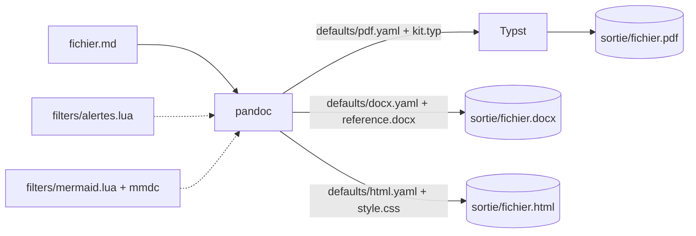

# pandoc-markdown

Chaîne de production de documents : un fichier **Markdown** (GFM) en entrée, **PDF**, **DOCX** et **HTML** en sortie à la charte **Forge & Lumière** (version papier), avec pandoc, Typst et mermaid-cli. Réglages dans des fichiers, aucune ligne de commande à retenir.

## Ce que c'est

Un dépôt de réglages pandoc (`defaults/`), de gabarits (`templates/`), de filtres (`filters/`) et de deux scripts d'appel (`scripts/`). Il n'y a pas de code applicatif : tout est configuration, lisible et versionnable.



## Ce que ça fait

- Convertit un `.md` en PDF (moteur Typst, gabarit A4 français), en DOCX (styles d'un `reference.docx`) et en HTML autonome (une page, CSS et images incluses).
- Rend les **alertes GitHub** (`> [!NOTE]` …) en encadrés portables, et les blocs **Mermaid** en images (SVG pour PDF et HTML, PNG pour DOCX).
- Conserve tableaux, cases à cocher, notes de bas de page, formules LaTeX, emoji.
- Applique la charte Forge & Lumière papier (Roboto, palette abysse / cyan / rouille, encarts LEGENDE, code sur fond abysse) aux trois formats ; polices livrées, rendu identique partout ([ADR 0002](docs/adr/0002-charte-forge-lumiere-papier.md)).
- Un format = un fichier dans `defaults/` ; un style = un fichier dans `templates/`.

Outils comparables : **Pandoc + LaTeX** (référence historique, installation lourde) ; **Quarto** (open source, maintenu, sur-ensemble de pandoc orienté publication scientifique) ; **mdBook** (open source, Rust, sites de documentation) ; **Typst** seul avec le paquet `cmarker` (open source) ; **Marked 2**, **Typora** (propriétaires, export PDF depuis l'éditeur) ; **Obsidian** (export PDF intégré, propriétaire, sans DOCX).

## Ce que ça ne fait pas

- Pas de PPTX : hors périmètre (les présentations ont leur propre chaîne).
- Pas de mise en page fine (colonnes, encarts flottants) : Markdown décrit une structure, le gabarit décide du reste.
- Pas de rendu Mermaid sans `mmdc` : le bloc reste en code et un message le dit.
- Polices : le PDF embarque Roboto et Roboto Mono (livrées) ; DOCX et HTML utilisent celles du lecteur ; les emoji demandent une police emoji installée.
- Ne fait pas le café — mais convertirait volontiers la carte des cafés du bar d'en bas en PDF A4, DOCX pour le patron et HTML pour l'ardoise numérique, à partir du même fichier.

## Installation

Pandoc **3.1.2 ou plus** (support de Typst), Typst, et mermaid-cli pour les schémas.

```powershell
winget install --id JohnMacFarlane.Pandoc
winget install --id Typst.Typst
winget install --id OpenJS.NodeJS.LTS      # si node n'est pas installé (mermaid-cli en dépend)
npm install -g @mermaid-js/mermaid-cli
```

Après `npm install -g`, **rouvrir le terminal** pour que `mmdc` soit dans le `PATH`.

```bash
# Linux / macOS : pandoc depuis les releases GitHub (les dépôts distribuent souvent une 2.x), typst via cargo
cargo install typst-cli
npm install -g @mermaid-js/mermaid-cli
```

Vérification :

```bash
pandoc --version | head -1
typst --version
mmdc --version
```

> attendu : `pandoc 3.x`, `typst 0.1x`, `12.x` (ou plus récents).

## Usage

```bash
scripts/build.sh exemples/demo.md all
```

```powershell
.\scripts\build.ps1 exemples\demo.md -Format all
```

> attendu : `exemples/sortie/demo.pdf`, `exemples/sortie/demo.docx`, `exemples/sortie/demo.html` ; schémas rendus dans `exemples/sortie/mermaid/`.

Sans script : `pandoc -d defaults/pdf.yaml dossier/fichier.md -o dossier/sortie/fichier.pdf`, depuis la racine du projet. Règle : **une sortie vit à côté de sa source**, dans un sous-dossier `sortie/` (jamais versionné).

Titre, auteur et date se donnent en tête du fichier Markdown :

```markdown
---
title: Mon document
author: Nom
date: 2026-10-16
---
```

## Structure

```text
pandoc-markdown/
├── README.md                 ce fichier
├── CHANGELOG.md              historique des versions
├── .env.example              noms des variables reconnues (facultatives)
├── defaults/                 un fichier de réglages pandoc par format
├── templates/                gabarits à la charte : kit.typ (PDF), reference.docx, style.css, fonts/
├── filters/                  filtres Lua : alertes GitHub, schémas Mermaid
├── scripts/                  build.sh, build.ps1
├── exemples/                 demo.md (test de non-régression), aide-mémoire Markdown (test de charge)
├── docs/adr/                 décisions d'architecture
├── docs/kit-documentaire/    kit documentaire PDF (généré)
└── <dossier>/sortie/         fichiers produits, à côté de leur source — non versionnés
```

Chaque dossier a son README.

## Vérifier qu'un changement n'a rien cassé

```bash
scripts/build.sh exemples/demo.md all && scripts/build.sh exemples/aide-memoire-markdown.md pdf
```

> attendu : aucune erreur ; `demo.pdf` sur 2 pages avec le schéma et l'alerte ; `aide-memoire-markdown.pdf` sur une quinzaine de pages, aucun tableau coupé.

## Feuille de route

| Gate | Livrable | État |
|---|---|---|
| G0 | Cadrage : option A (recettes pandoc), formats PDF + DOCX + HTML, charte neutre puis Forge & Lumière | ✅ |
| G1 | Squelette : defaults, gabarits, filtres, scripts, exemples, ADR 0001 — les trois formats passent sur `demo.md` | ✅ (vérifié avec pandoc 3.1.3 et 3.9.0.1, Typst 0.14/0.15, mermaid-cli 11/12, Linux et Windows) |
| G2 | Mise en page : alertes colorées en PDF, pied de page robuste, étiquettes Mermaid, contrôle page par page de l'aide-mémoire | ✅ |
| G2 bis | Charte Forge & Lumière papier portée en `kit.typ`, `reference.docx`, `style.css`, thème Mermaid clair, polices livrées | ✅ |
| G3 | Kit documentaire généré par le skill dans `docs/kit-documentaire/` | ⬜ |
| G4 | Audit indépendant | ⬜ |
| C | Image conteneur pandoc + typst + mermaid-cli, versions épinglées | ⬜ |

Limites connues au G1 : pandoc 3.1.x affiche un avertissement sur certaines formules en bloc (`\bar{x}` dans une racine) mais les rend ; les emoji du PDF dépendent de la police installée ; les tableaux larges sont réduits à 90 % sans retour à la ligne forcé ; sans `mmdc`, les schémas restent en bloc de code (message `[mermaid.lua]` sur la sortie d'erreur, génération poursuivie).
