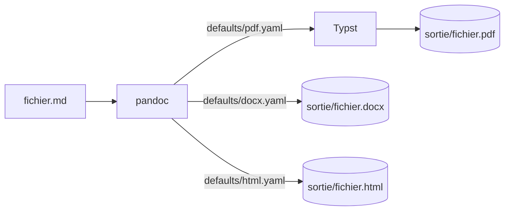

## Objet

Ce fichier exerce chaque construction prise en charge par la chaîne : titres, mise en forme, listes, tableau, bloc de code, alerte GitHub, schéma Mermaid, formule, note de bas de page.

Texte avec **gras**, *italique*, ~~barré~~, `code`, un lien vers [la documentation pandoc](https://pandoc.org/MANUAL.html) et une note[^1].

### Liste et tâches

1. Première étape
2. Deuxième étape
   - sous-point
- [x] fait
- [ ] à faire

### Tableau

| Réglage | Valeur | Rôle |
|---|---:|---|
| `papersize` | a4 | Format de page |
| `lang` | fr | Césure et typographie |

### Code

```bash
pandoc -d defaults/pdf.yaml exemples/demo.md -o sortie/demo.pdf
```

### Alerte

> [!WARNING]
> Une valeur réelle de configuration ne se recopie jamais dans un document : noms de variables seulement.

### Schéma



### Formule

La moyenne $\bar{x} = \frac{1}{n}\sum_{i=1}^{n} x_i$ et, sur sa ligne :

$$
\sigma = \sqrt{\frac{1}{n}\sum_{i=1}^{n}(x_i - \bar{x})^2}
$$

[^1]: Texte de la note de bas de page.
